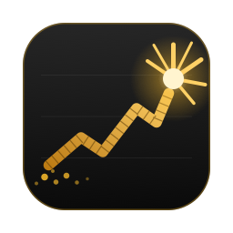

<p align="center">
  
</p>

<h1 align="center">Powder</h1>

<p align="center"><b>A native macOS trading terminal for Hyperliquid. Keyboard-first, monospaced, fast.</b></p>


Powder is a single SwiftUI app: no Electron, no web view around the chart, no account, no server of ours in the middle. Orders are signed on your Mac and sent straight to the exchange.

## Features

- **Split panes and tabs.** Arrange markets side by side, drag tabs between panes, and the layout is saved as you go.
- **Charts.** Six chart types, 14 intervals, MA / EMA / Bollinger / VWAP / RSI / MACD, drawings, and your entry and liquidation levels on the chart.
- **Trading.** Market and limit orders from a ticket or one key, with a size slider capped at what the wallet can afford. Order book and trade tape beside every chart.
- **Wallets.** Any number of wallets or Hyperliquid API wallets. Keys live in the macOS Keychain and never leave it.
- **Positions and markets.** Every position, balance and idle dollar across wallets in one live table; every perp in another.
- **Solana tokens.** Search any token and chart it on [Codex](https://codex.io) data (bring your own API key). Read-only for now.
- **Web tabs.** Keep a site or a feed next to your charts.
- **Ask AI (`⌘K`).** Uses the `claude` or `codex` CLI already signed in on your Mac. It can arrange your workspace and read market data through Powder's built-in MCP server. It has no tool that can place, cancel or close an order.

## Install

Requires macOS 14+ and Xcode 15+.

```bash
git clone https://github.com/fiberevm/powder.git
cd powder
./Scripts/package_app.sh && open .build/Powder.app
```

Or run it without packaging: `swift run Powder`.

## Keys

| Key | Action |
| --- | --- |
| `⌘P` | open a market, token, site or command |
| `⌘K` | ask the AI |
| `s` / `⌘D` | split the pane |
| `⌥` + arrows | move between panes |
| `[` `]` | change the candle interval |
| `⇧B` / `⇧S` | buy / sell with the ticket's size |
| `⌘,` | wallets and settings |
| `?` | every other key |

## Before you trade

Powder trades on **Hyperliquid mainnet with real funds**. `⇧B` and `⇧S` send the order immediately, with no confirmation step. There is no testnet mode yet, and no stop or take-profit orders.

This software is provided as is. It is not financial advice, and you are responsible for every order it sends.

## Development

```bash
swift build
swift test
```

The code is one SwiftPM target under `Sources/PowderApp`, with a single dependency ([swift-secp256k1](https://github.com/21-DOT-DEV/swift-secp256k1)) for signing. `DESIGN.md` and `PRODUCT.md` describe the look and the intent.
