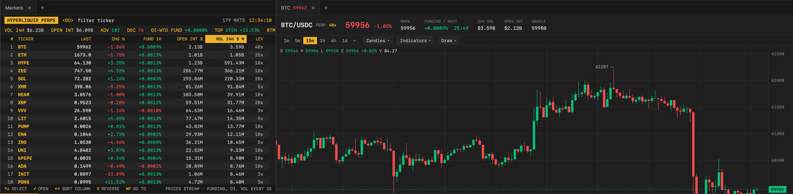

<p align="center">
  
</p>

<h1 align="center">Powder</h1>

<p align="center"><b>A native macOS trading terminal for Hyperliquid and Solana. Keyboard-first, monospaced, fast.</b></p>



Powder is a single SwiftUI app: no Electron, no web view around the chart, no account, no server of ours in the middle. Orders are signed on your Mac and sent straight to the exchange.

## Features

- **Split panes and tabs.** Arrange markets side by side, drag tabs between panes, and the layout is saved as you go.
- **Charts.** Six chart types, 14 intervals, MA / EMA / Bollinger / VWAP / RSI / MACD, drawings, and your entry and liquidation levels on the chart.
- **Trading.** Market and limit orders from a ticket or one key, with a size slider capped at what the wallet can afford. Order book and trade tape beside every chart.
- **Wallets.** Any number of wallets or Hyperliquid API wallets. One private key gives a Hyperliquid address and a Solana address. Keys live in the macOS Keychain and never leave it.
- **Positions and markets.** Every position, balance and idle dollar across wallets in one live table; every perp in another.
- **History.** Every fill and swap across wallets in one table (`⇧⌘Y`), with volume over 24 hours, 7 and 30 days, fees and realized PnL.
- **Chart trading.** Right-click the chart for a limit order, an alert or a price line at that price. Resting orders and alerts are drawn on the chart, and one command cancels every order.
- **Watchlist and alerts.** Star markets from either venue into one live list (`w`), and get a notification when a price is reached.
- **Liquidations.** Every Hyperliquid liquidation as it happens, with long and short totals (needs a [GoldRush](https://goldrush.dev) API key; Hyperliquid's own API only reports them per account).
- **Token safety.** Each Solana token shows whether it can still be minted or frozen, how concentrated its holders are, its liquidity and age, with its links opening inside Powder.
- **Solana tokens.** Search any token, chart it on [Codex](https://codex.io) data (bring your own API key), and buy or sell it: routed by [Jupiter](https://jup.ag), signed on your Mac, landed through [Nozomi](https://use.temporal.xyz). Your average entry is drawn on the chart, and PnL comes from what the wallet actually paid.
- **One search.** `⌘P` lists Hyperliquid perps and Solana tokens together, with logos, most traded first.
- **Web tabs.** Keep a site or a feed next to your charts.
- **Ask AI (`⌘K`).** Uses the `claude` or `codex` CLI already signed in on your Mac. It can arrange your workspace and read market data through Powder's built-in MCP server. It has no tool that can place, cancel or close an order.

## Order submission

How an order gets from a keypress to the exchange, compared with the two common kinds of Hyperliquid terminal:

| | Powder | Browser terminal | Telegram or hosted bot |
| --- | --- | --- | --- |
| Signed | on your Mac, natively (under 1 ms) | in the browser tab | on the operator's server |
| Key lives | macOS Keychain | browser storage or a wallet extension | with the operator |
| Path to the exchange | direct to Hyperliquid's API | direct, or through the terminal's backend | your chat app, then their server, then the exchange |
| Extra fee | none | often a builder fee | usually a fee per trade |
| From intent to sent | one key, no confirmation | click, sometimes a wallet popup | a message round trip |

**Measured:** a market order from Powder is acknowledged as filled in about 730–890 ms on a home connection in western Canada. Signing is under a millisecond and the network round trip about 120 ms; the rest is Hyperliquid's public API, which every terminal using it pays too. Powder keeps the connection warm and syncs leverage ahead of time so nothing else is added.

We have not benchmarked other terminals, so the table compares how they work rather than how fast they are.

**Solana** swaps take one more step: Jupiter prices a route and returns the transaction, Powder adds a tip, signs it locally and sends it to Nozomi, which gets it to the block leader. The tip (0.001 SOL by default, Nozomi's minimum) is only charged when the swap lands. Add your Nozomi API key in Settings → Solana; without one, swaps fall back to the public RPC.

## Install

Requires macOS 14+ and Xcode 15+.

```bash
git clone https://github.com/fiberevm/powder.git
cd powder
./Scripts/package_app.sh && open .build/Powder.app
```

Or run it without packaging: `swift run Powder`.

## Keys

| Key | Action |
| --- | --- |
| `⌘P` | open a market, token, site or command |
| `⌘K` | ask the AI |
| `s` / `⌘D` | split the pane |
| `⌥` + arrows | move between panes |
| `[` `]` | change the candle interval |
| `⇧B` / `⇧S` | buy / sell with the ticket's size |
| `⌘,` | wallets and settings |
| `?` | every other key |

## Before you trade

Powder trades on **Hyperliquid and Solana mainnet with real funds**. `⇧B` and `⇧S` send the order immediately, with no confirmation step. There is no testnet mode yet, and no stop or take-profit orders.

This software is provided as is. It is not financial advice, and you are responsible for every order it sends.

## Development

```bash
swift build
swift test
```

The code is one SwiftPM target under `Sources/PowderApp`, with a single dependency ([swift-secp256k1](https://github.com/21-DOT-DEV/swift-secp256k1)) for signing. `DESIGN.md` and `PRODUCT.md` describe the look and the intent.
